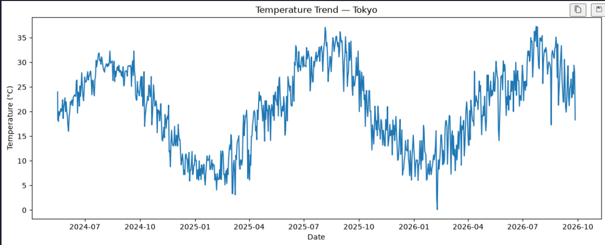
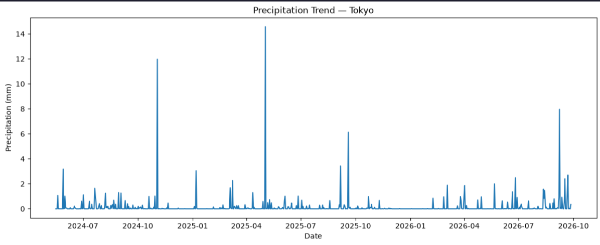
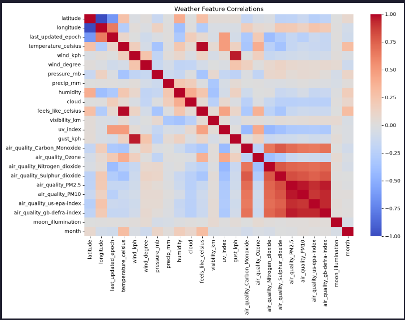
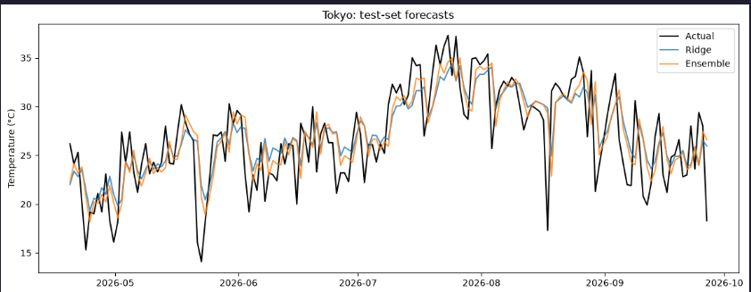
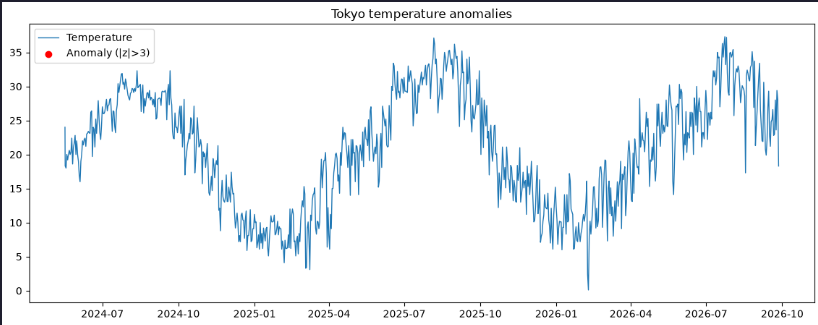
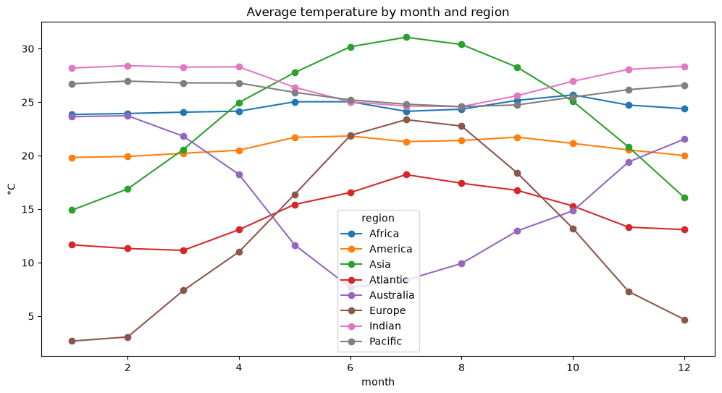
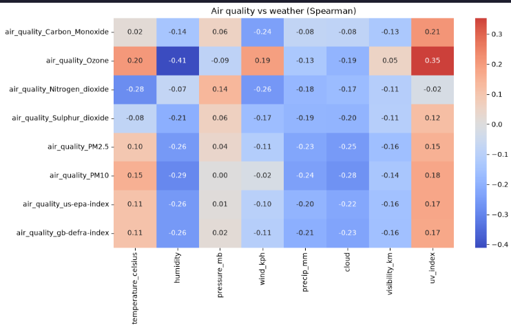
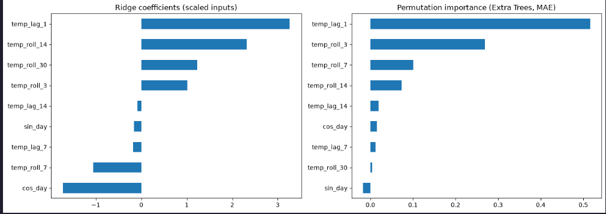
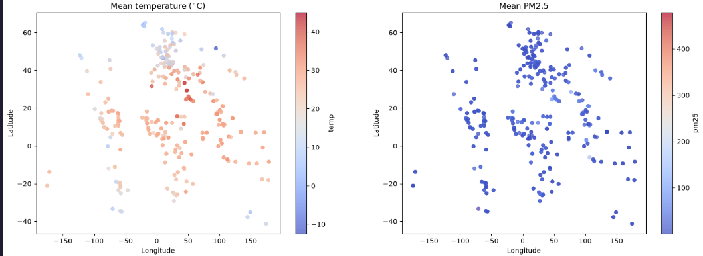
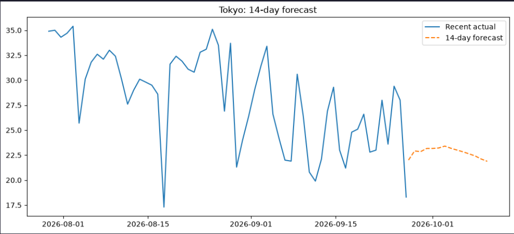

# Global Weather Forecasting

Forecasting daily temperature from the Global Weather Repository, with some exploratory work on air quality, anomalies and geography along the way.

## What's in this repo

```
.
├── data/
│   └── GlobalWeatherRepository.csv        # not included, see "Data" below
├── EDA_Feature_Engineering_and_Visualization.ipynb
├── Model_training.ipynb
├── models/
│   └── ridge_tokyo.joblib                 # saved best model
├── screenshots/                           # figures used in this README
├── requirements.txt
└── README.md
```

1. **EDA_Feature_Engineering_and_Visualization.ipynb** covers cleaning, scaling, EDA, anomaly detection, regional and air-quality analysis, and exports the Tokyo series used for forecasting.
2. **Model_training.ipynb** covers feature building, ten forecasting models plus an ensemble, evaluation, feature importance and a 14-day forecast.

## Data

The dataset is the [Global Weather Repository](https://www.kaggle.com/datasets/nelgiriyewithana/global-weather-repository) on Kaggle: daily weather snapshots for cities around the world, over 167,000 rows and 41 columns in the copy I used. It has temperature, precipitation, wind, pressure, humidity, cloud cover, UV, air quality readings, and each city's coordinates and timezone.

The CSV is too large to commit, so download it and put it in `data/` as `GlobalWeatherRepository.csv`.

## How to run

```bash
git clone https://github.com/sleepy-kittens-404/global-weather-forecasting.git
cd global-weather-forecasting
pip install -r requirements.txt
```

Put the CSV in `data/`, then run the notebooks **in this order**. The first one writes `data/tokyo.csv`, which the second one reads.

1. `EDA_Feature_Engineering_and_Visualization.ipynb`
2. `Model_training.ipynb`

## What I did

### Cleaning

- There were no missing values or duplicate rows in the raw file.
- Dropped the imperial-unit columns (Fahrenheit, mph, inches, miles), which only repeat the metric ones.
- A few rows had impossible values: pressure far outside 900 to 1100 mb, temperatures above 60 °C, wind above 200 kph, negative particulate readings. I set those to missing and filled them with that city's own median. I didn't drop the rows because the rest of each row looked fine.
- I kept high PM2.5 and PM10 readings on purpose. They're common in polluted cities, so treating them as errors would have thrown away real signal.
- Standardized the numeric columns into a separate scaled copy. The original stays in real units for plots, and Ridge gets its own scaler inside a pipeline.

### EDA

- Distributions and a correlation heatmap across all numeric features, then the most common weather conditions and how temperature varies across them.
- Temperature and precipitation trends over time for Tokyo.
- Seasonal temperature and average precipitation by region. There's no continent column, so I derived the region from the `timezone` field.





### Forecasting setup

I forecast **daily temperature for Tokyo**, using `last_updated` as the time index. Tokyo was picked because it has a long, continuous run of daily records (about 600 days).

- **Features:** temperature at lags of 1, 7 and 14 days, rolling means over 3, 7, 14 and 30 days, and sin/cos of the day of year to capture the seasonal cycle.
- **No leakage:** rolling windows are shifted by one day so a row never sees its own target. I only use past temperature as input, not same-day humidity or pressure, since those wouldn't be known in advance.
- **Split:** the first 80% of days for training and the last 20% for testing, in time order, no shuffling.

### Models

| Group | Models |
|---|---|
| Baselines | Naive (yesterday), Seasonal Naive (7 days ago) |
| Classical time series | ARIMA(2,1,2), SARIMAX with yearly sin/cos terms, damped exponential smoothing |
| Machine learning | Ridge (scaled, alpha tuned with time-series CV), Random Forest, Extra Trees, HistGradientBoosting, XGBoost |
| Ensemble | Average of Ridge, Extra Trees and Naive |

All models are scored on the same task: predicting each test day one day ahead. The classical models see each new actual value as it arrives but keep their fitted parameters fixed, except exponential smoothing, which is refit every day. I evaluate with MAE, RMSE and R². I also ran 5-fold time-series cross-validation on the ML models, because one split can crown a winner by luck.

## Results

TODO: paste the table from `results_df.round(3).to_markdown(index=False)`



TODO: one or two sentences on which model won and whether the ensemble beat its parts.

TODO: one sentence on the cross-validation result and whether the ranking held.

## Advanced analyses

**Anomaly detection.** Two methods: a per-city z-score on temperature (|z| > 3), which judges each city against its own normal, and an Isolation Forest on eight weather variables, which catches unusual combinations. TODO: what you found, e.g. which countries had the most anomalies.



**Climate and regional patterns.** Average temperature by month and region, plus temperature against latitude. The data covers only about a year or two, so this shows seasonal patterns, not long-term climate change. TODO: one sentence on what stood out.



**Air quality vs weather.** Spearman correlations between each pollutant and the weather variables, since pollutant values are heavily skewed. TODO: strongest relationships you saw (wind? precipitation? humidity?).



**Feature importance.** Ridge coefficients on scaled inputs, and permutation importance on Extra Trees. TODO: which features mattered most.



**Spatial and geographic patterns.** City-level maps of mean temperature and PM2.5 from latitude and longitude, and the cleanest vs most polluted countries. TODO: one sentence on the pattern.



**Future forecast.** The best model is rolled forward 14 days, feeding each prediction back in as the next lag.



## Limitations

- Only one city was modeled. Results for Tokyo won't necessarily carry over elsewhere.
- Roughly 600 days is less than two full years, so the yearly cycle is learned from very few repeats. That limits every model, and is probably why tree models didn't beat a linear one.
- Scores are one-day-ahead. The 14-day forecast feeds predictions back in, so errors compound and it drifts toward the seasonal average.
- Outlier thresholds (for example 900 to 1100 mb for pressure) are my judgment, not a standard.

## Possible next steps

- Model several cities, or one model with city as a feature.
- Add a proper multi-day-ahead evaluation instead of only one-step-ahead.
- Bring in a longer history so the seasonal models have more to learn from.

## Requirements

Python 3.10+, see `requirements.txt`.